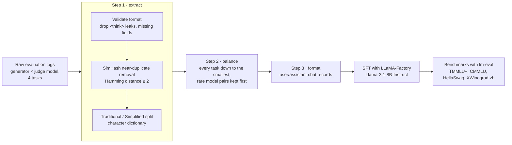
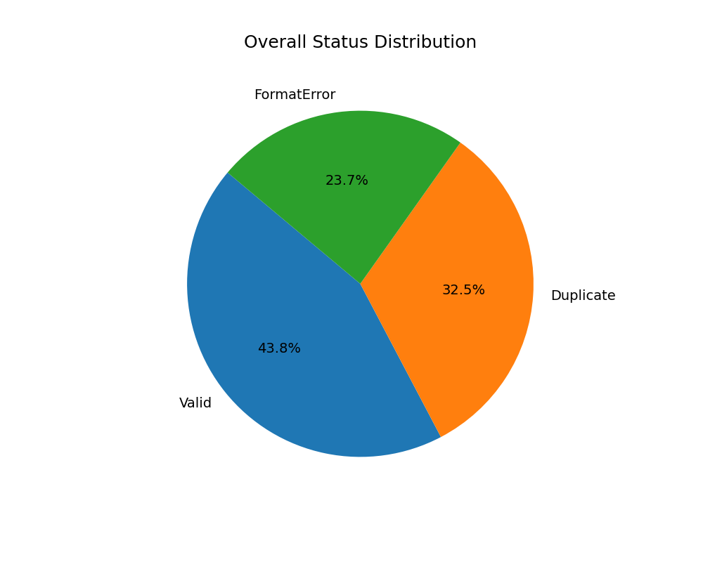
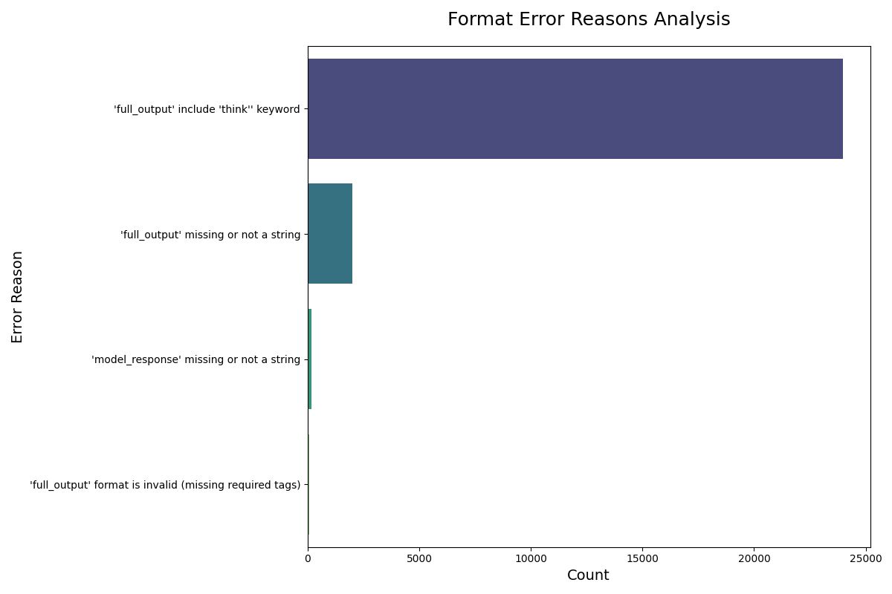
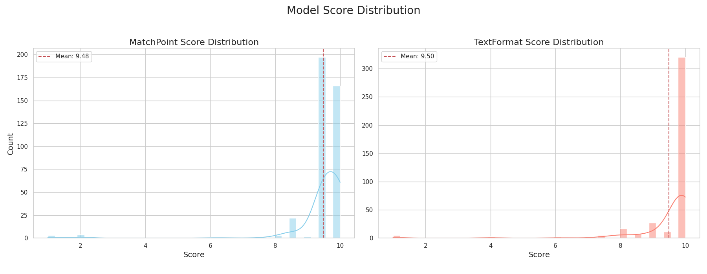

# sft_project — training data for a Traditional Chinese LLM-as-a-Judge

**English** · [繁體中文](README.zh-TW.md)

A data pipeline that turns raw LLM evaluation logs into a clean supervised fine-tuning set for a
**Traditional Chinese judge model**. The judge scores answers on four public-sector writing tasks:
official documents (`od`), petitions (`petition`), press releases (`press`) and Q&A (`qa`).

The scripts started as standalone files and were refactored into one package with a single CLI
(`cli.py`), Docker support and switches for ablation studies.



## What the data looked like

<p align="center">


</p>

In one extraction run, fewer than half of the raw records were usable: **43.8% valid, 32.5%
near-duplicates, 23.7% malformed**. Most malformed records were reasoning traces (`think`) that
leaked into the judge output.

<p align="center"></p>

The judge labels are heavily skewed toward high scores (mean about 9.5 out of 10 on both
MatchPoint and TextFormat). That skew is why balancing and a separate adversarial test set
mattered.

## Pipeline

| Step | Module | What it does |
|---|---|---|
| 1. Extract | `training_pipeline/step1_extract.py` | Walks the evaluation logs, parses generator and judge model from each path, and rejects malformed records. Removes near-duplicates with 64-bit SimHash (`--dedup_threshold`, default 2). Splits Traditional from Simplified Chinese with a character list (`simplified_chars.txt`). |
| 2. Balance | `training_pipeline/step2_balance.py` | Down-samples every task to the size of the smallest. Generator/judge pairs with the fewest records are kept first, so model diversity survives. |
| 3. Format | `training_pipeline/step3_format.py` | Builds `{"messages": [user, assistant]}` records. The user turn holds the original task, the reference answer and the response to judge. |

### Ablation switches

`scripts/generate_ablation_datasets.sh` builds five training sets from the same logs. Each one
switches off one cleaning step:

| Dataset | Flag |
|---|---|
| `judge_sft_full` | none |
| `judge_sft_no_tc_only` | `--keep-simplified` |
| `judge_sft_no_simhash` | `--no-simhash` |
| `judge_sft_no_think` | `--keep-think` |
| `judge_sft_raw` | all three |

`scripts/ablation_run_all.sh` trains one LoRA adapter per set with LLaMA-Factory on a Slurm +
Singularity cluster. `scripts/eval_benchmarks.sh` scores the result with lm-evaluation-harness.

## Usage

```bash
uv pip install .          # or: pip install -r requirements.txt

# full pipeline: extract → balance → format
python cli.py process-training-data --step1_input_dir ./eval_results

# other commands
python cli.py prepare-inference-data --input_dir <raw-jsonl-dir>
python cli.py analyze-length --dataset_file <file.jsonl> --model_name meta-llama/Meta-Llama-3.1-8B-Instruct
python cli.py visualize-data --metadata_file ./final_classified_output/full_metadata_log.json
python cli.py analyze-eval-results --prediction_file <model_predictions.jsonl>
```

Run `python cli.py <command> --help` for every option.

With Docker:

```bash
docker build -t sft-processor .
docker run --rm -v "$PWD/eval_results:/app/eval_results" -v "$PWD/out:/app/out" \
  sft-processor process-training-data --step1_input_dir /app/eval_results --step3_output_dir /app/out
```

### Supporting scripts

| Script | Purpose |
|---|---|
| `eval_local.py` | Batched local inference of a fine-tuned judge with `transformers` |
| `analyze_prediction.py`, `generate_charts.py`, `generate_md_report.py` | Compare judge predictions with reference labels and write charts and a Markdown report |
| `create_mismatched.py` | Build adversarial pairs whose response does not belong to the task |
| `expand_responses.py`, `extract_sample_and_format.py` | Sample and reformat records for annotation |
| `scripts/create_blind_test.py` | Blind A/B sheet for comparing two judges |
| `src/sft_project/analysis/argilla_to_*.py` | Convert Argilla annotation exports into DPO pairs or a judge test set |
| `trace_source_files.py` | Map a training record back to the log file it came from |

## Not in this repository

The evaluation logs, the derived training sets, model predictions and trained weights are
internal to the project and are not published. To run the pipeline on your own data, lay the logs out as
`eval_results/<generator>/<judge>/<file>.jsonl`, with the task name (`od`, `petition`, `press`
or `qa`) somewhere in each file name.
Each JSONL line needs `prompt`, `resp` (reference answer), `model_response` and `full_output`
(the judge's text). `full_output` must contain the tags `【給分原因】`, `【分數】`,
`題文匹配度(MatchPoint)` and `文本格式(TextFormat)`, or the record is counted as malformed.
