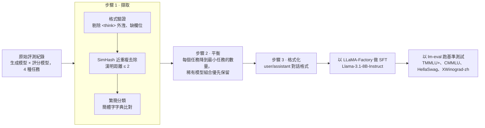

# sft_project — 繁體中文 LLM-as-a-Judge 的訓練資料流程

[English](README.md) · **繁體中文**

這個專案把原始的 LLM 評測紀錄整理成乾淨的監督式微調（SFT）資料，用來訓練**繁體中文的評分模型（judge）**。judge 負責替四種公部門寫作任務的回答打分數：
- 公文（`od`）
- 陳情（`petition`）
- 新聞稿（`press`）
- 問答（`qa`）

原本是一堆獨立的 script，後來重構成一個 package：統一由 `cli.py` 執行，支援 Docker，也有做消融實驗用的開關。



## 原始資料長什麼樣

<p align="center">


</p>

在其中一次擷取裡，原始紀錄能用的不到一半：
- **43.8% 有效**
- **32.5% 近重複**
- **23.7% 格式錯誤**

格式錯誤大多是推理過程（`think`）混進了 judge 的輸出。

<p align="center"></p>

judge 給的分數嚴重偏高：MatchPoint 和 TextFormat 的平均都約 9.5 分（滿分 10 分）。所以資料平衡和另外準備一份對抗測試集才這麼重要。

## 流程

| 步驟 | 模組 | 做什麼 |
|---|---|---|
| 1. 擷取 | `training_pipeline/step1_extract.py` | 走訪評測紀錄，從路徑解析生成模型和評分模型，剔除格式錯誤的紀錄。用 64 位元 SimHash 去除近重複（`--dedup_threshold`，預設 2），再用簡體字清單（`simplified_chars.txt`）分出繁體和簡體。 |
| 2. 平衡 | `training_pipeline/step2_balance.py` | 每個任務都降採樣到最小任務的數量。資料最少的「生成模型/評分模型」組合優先保留，以維持模型多樣性。 |
| 3. 格式化 | `training_pipeline/step3_format.py` | 產生 `{"messages": [user, assistant]}` 格式的紀錄。user 內容包含原始任務、參考答案和待評分的回覆。 |

### 消融實驗開關

`scripts/generate_ablation_datasets.sh` 會從同一批紀錄產生五份訓練集，每份關掉一個清理步驟：

| 資料集 | 參數 |
|---|---|
| `judge_sft_full` | 無 |
| `judge_sft_no_tc_only` | `--keep-simplified` |
| `judge_sft_no_simhash` | `--no-simhash` |
| `judge_sft_no_think` | `--keep-think` |
| `judge_sft_raw` | 三個都加 |

- `scripts/ablation_run_all.sh`：在 Slurm + Singularity 叢集上，用 LLaMA-Factory 對每份資料集各訓練一個 LoRA adapter。
- `scripts/eval_benchmarks.sh`：用 lm-evaluation-harness 跑基準測試。

## 使用方式

```bash
uv pip install .          # 或：pip install -r requirements.txt

# 完整流程：擷取 → 平衡 → 格式化
python cli.py process-training-data --step1_input_dir ./eval_results

# 其他指令
python cli.py prepare-inference-data --input_dir <raw-jsonl-dir>
python cli.py analyze-length --dataset_file <file.jsonl> --model_name meta-llama/Meta-Llama-3.1-8B-Instruct
python cli.py visualize-data --metadata_file ./final_classified_output/full_metadata_log.json
python cli.py analyze-eval-results --prediction_file <model_predictions.jsonl>
```

每個指令的完整選項請看 `python cli.py <command> --help`。

用 Docker 執行：

```bash
docker build -t sft-processor .
docker run --rm -v "$PWD/eval_results:/app/eval_results" -v "$PWD/out:/app/out" \
  sft-processor process-training-data --step1_input_dir /app/eval_results --step3_output_dir /app/out
```

### 輔助 script

| Script | 用途 |
|---|---|
| `eval_local.py` | 用 `transformers` 在本機批次推論微調後的 judge |
| `analyze_prediction.py`、`generate_charts.py`、`generate_md_report.py` | 比對 judge 預測和參考標籤，輸出圖表與 Markdown 報告 |
| `create_mismatched.py` | 產生「回覆不屬於該任務」的對抗配對 |
| `expand_responses.py`、`extract_sample_and_format.py` | 抽樣並整理成標註用的格式 |
| `scripts/create_blind_test.py` | 比較兩個 judge 的盲測表 |
| `src/sft_project/analysis/argilla_to_*.py` | 把 Argilla 標註匯出轉成 DPO 配對或 judge 測試集 |
| `trace_source_files.py` | 從訓練紀錄回推它來自哪個紀錄檔 |

開發過程中遇到的問題和修正記錄在 [`docs/Fix_Report.zh-TW.md`](docs/Fix_Report.zh-TW.md)。

## 不在 repo 裡的東西

評測紀錄、整理後的訓練集、模型預測和訓練好的權重都屬於專案內部資料，不公開。

如果要用自己的資料跑這個流程，紀錄檔要放成 `eval_results/<生成模型>/<評分模型>/<檔名>.jsonl`，而且檔名裡要包含任務名稱（`od`、`petition`、`press` 或 `qa`）。

每一行 JSONL 需要四個欄位：
- `prompt`
- `resp`：參考答案
- `model_response`
- `full_output`：judge 的輸出

`full_output` 必須包含 `【給分原因】`、`【分數】`、`題文匹配度(MatchPoint)`、`文本格式(TextFormat)` 這四個標記，否則會被算成格式錯誤。
